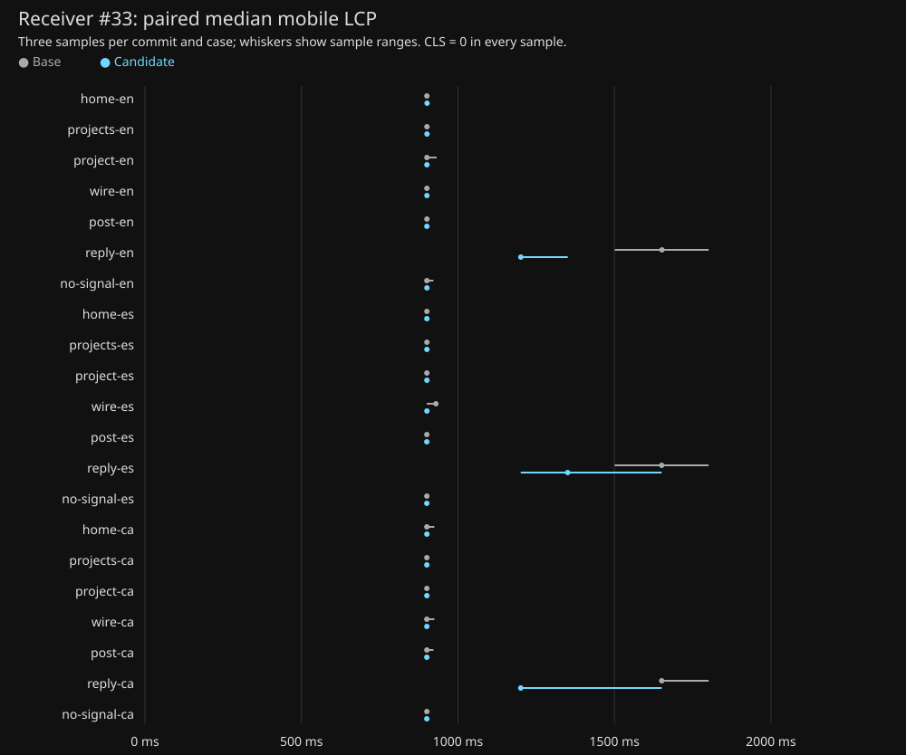

# Receiver first-load startup evidence — #33

PR: https://github.com/lutzseverino/receiver/pull/34 . Base: ef8c164d29f642f2b145bae88fdc5ac56abac4b2. Candidate: 4d3e345d6782bbb440c211189d517cc3efc71bfc.

This evidence uses complete production fixture builds with the same committed projects and posts as #30. The receiver is enabled, storage starts empty, and normal motion/full-load intro runs in every Lighthouse sample. Nothing blocks the receiver for an acceptance score. Direct NO SIGNAL pages retain noindex and are exempt only from the numerical SEO gate.

## Measurement

Lighthouse 13.6.0, Chrome for Testing 153.0.8010.12, Node 24.22.2, pnpm 11.28.10, Linux SwiftShader. The #30 command and flags are unchanged: `--chrome-flags='--headless --no-sandbox --enable-unsafe-swiftshader' --output=json --output=html --quiet`. Standard simulated mobile throttling: 412×823, DPR 1.75, RTT 150 ms, throughput 1638.4 Kbps, CPU slowdown 4. All samples run serially on the same host; no other task browser worker runs during the measurement. Three interleaved base/candidate pairs per page-locale, seven page types × en/es/ca, 126 reports. Each JSON includes raw audit values, configSettings and browser/version metadata; summary.json retains medians and sample ranges.

The opaque near-black cover leaves the semantic HTML painted beneath it, so Chrome retains a valid HTML LCP candidate. LCP does **not** measure when the display becomes visible. These reports claim preservation of the required category scores, not a faster visible display based on concealed HTML. See the separate compositor filmstrips and startup performance marks for visible timing. An early-clipping experiment produced NO_FCP in all three home samples and was rejected.

## Visual and failure evidence

`visuals/` compares decoded RGB pixels for all 21 page-locales at 390×844 plus the approved Projects 1280×600 and Reply 720×320 in all locales (27 pairs). Reduced motion yields settled states; normal motion remains enabled in Lighthouse and the corresponding startup filmstrips.

`filmstrips/` records cold/warm loads of all seven page types including deep links and direct localized NO SIGNAL, en/es/ca, desktop/phone, normal/reduced motion (168 traces). `filmstrips-extra/` adds locale redirects and actual slow-network/CPU startup. For filmstrips only, a transparent local proxy adds test-controlled one-hour caching to fingerprinted assets and no-store to HTML. Each cold case clears the private browser cache; warm cases prime a complete startup then reload, and resource timings verify zero transferred asset bytes. This is a cache test condition, not deployment configuration; the paired Lighthouse harness remains unchanged. JPEG frames and compressed Chrome traces retain compositor timing beside receiver:gate, receiver:first-frame (draw completion acknowledgement) and receiver:plain (recovery) marks. A worker acknowledgement is not a compositor presentation measurement; first visible display timing is read separately from captured frames.

`branches.json` and `races.json` record saved PLAIN, no JavaScript, blocked inline script, no WebGL/throwing probe, denied storage, missing Worker/OffscreenCanvas/transfer APIs, worker initialization refusal/error, late draw, blocked receiver and worker chunks, module download delayed beyond the original deadline, and real page freeze/resume. The recovery never changes the saved PLAIN preference or permits a late covering display. The repository's nine added startup browser tests and existing receiver interaction/accessibility tests cover complementary first-frame, focus and post-start failure cases.

## Validation and limits

Full `SITE_PROJECTS=fixture pnpm validate`: 222/222 tests plus UI integrity, typecheck, lint, formatting and production build passed. Pinned repo-standards check passed. One previous full run had the already-reported display-audit startup timeout (receiver#23, cause unconfirmed); its isolated recheck and the subsequent complete run passed. No timeout or assertion was weakened. Route, viewport and startup timestamps are now included in future audit timeout errors.

Accessibility evidence uses axe WCAG 2.2 A/AA, Chrome's full accessibility tree, real link focus and keyboard activation. It does not claim a human-operated screen-reader session. Timer recovery occurs at the first runnable opportunity after suspension or main-thread blockage; no exact repaint deadline during suspension is claimed.

No display layout, shader, translated copy, discovery content or deployment configuration changed. Deployment PR #32 remains held. Findings are linked from #34: existing receiver#23 and repo-canon#813; no duplicate issues filed.

## Reproduce

Use Node 24 and the repository's documented pnpm installation. Check out the two source commits separately and install dependencies. `measure.ts` builds the fresh base and two rejected/diagnostic presentation variants; `candidate.ts` builds the candidate fixture. Start these from their corresponding checkout roots, then run matrix.mjs serially after both URL files exist. The scripts use a single per-task directory at /tmp/worker-33-2026-11-03; change that root consistently when reproducing. Point SITE_BROWSER and CHROME_PATH at the pinned Chrome executable. Set TMPDIR inside the task directory. Run visuals.ts, branches.ts and races.ts after Lighthouse completes. Start cache-server.mjs against the candidate fixture, then run filmstrip.ts and filmstrip-extra.ts, followed by analyze-frames.ts and gallery.mjs. Stop the fixture and cache-proxy server PIDs after capturing evidence. The fixture posts remain test-only and are not added to launch production.

## Paired Lighthouse medians

All required categories are 100 in every candidate sample; NO SIGNAL SEO alone is exempt. All CLS values are zero. Raw LCP values below are milliseconds.

| Case | Base LCP median | Candidate LCP median | Delta |
| --- | ---: | ---: | ---: |
| home-en | 900.741 | 901.284 | 0.543 |
| projects-en | 900.937 | 901.028 | 0.091 |
| project-en | 900.851 | 900.931 | 0.080 |
| wire-en | 900.745 | 900.815 | 0.071 |
| post-en | 900.850 | 900.697 | -0.154 |
| reply-en | 1651.814 | 1200.960 | -450.855 |
| no-signal-en | 900.687 | 900.871 | 0.185 |
| home-es | 900.754 | 900.706 | -0.048 |
| projects-es | 900.781 | 900.778 | -0.002 |
| project-es | 900.716 | 900.722 | 0.006 |
| wire-es | 929.653 | 900.799 | -28.854 |
| post-es | 900.584 | 900.476 | -0.107 |
| reply-es | 1650.998 | 1350.526 | -300.472 |
| no-signal-es | 900.632 | 900.485 | -0.147 |
| home-ca | 900.637 | 900.695 | 0.059 |
| projects-ca | 900.624 | 900.552 | -0.072 |
| project-ca | 900.635 | 900.665 | 0.030 |
| wire-ca | 900.605 | 900.594 | -0.011 |
| post-ca | 900.737 | 900.582 | -0.155 |
| reply-ca | 1651.113 | 1200.649 | -450.464 |
| no-signal-ca | 900.633 | 900.457 | -0.176 |

### Raw-timing investigation

The largest positive initial median delta was home-en: +0.543 ms. Three additional reversed-order pairs gave base median 900.593 ms and candidate 900.695 ms (+0.102 ms); paired deltas were -18.844, +0.039 and +0.102 ms. The original magnitude did not reproduce, ranges overlap, and pair direction varies. Other positive medians were <=0.185 ms with overlapping sample ranges. No reproducible LCP/CLS regression was established; these raw deltas remain published rather than hidden behind score rounding. Reply's lower simulated LCP uses the same portrait candidate in both builds and is not claimed as faster visible display presentation. All extra samples also score 100 in the four required categories with CLS zero. See investigation/ for all six reports.

## Acceptance outcomes

- 126/126 primary Lighthouse reports have every required category at 100 (NO SIGNAL SEO exemption retained), a numeric LCP audit and CLS zero. Six additional timing-investigation reports also pass. The 27 settled screenshot pairs have zero changed RGB channels.
- All 168 primary cold/warm traces and 16 redirect/slow traces reached first submitted draw. All 84 warm priming loads succeeded and their fingerprinted resources transferred zero bytes. None captured the ordinary plain-page layout before the display. Captured pending/new-document wait frames are exactly #030303. Two traces retain an initial outgoing about:blank white snapshot at gate +0.491/+2.312 ms, before the first near-black surface; neither shows a white or plain frame between that surface and the display. Raw frames and these classifications remain published for inspection.
- First submitted draw acknowledgements span 111.539–1456.461 ms after the gate. Independently captured first visible display frames span 247.884–1607.098 ms. Slow desktop runs illustrate the compositor delay after acknowledgement; the 1,500 ms watchdog bounds waiting for a first submitted draw, not a guaranteed wall-clock compositor presentation. No audit score is used as proof of visible display timing.
- All 14 branch cases passed, including actual HTTP refusal of the worker module and HTTP CSP blocking of inline scripts. Delayed receiver import recovers at about 1501 ms from the head gate, then creates zero workers when the download is released. A real frozen page remains hidden on lifecycle activation and recovers when visibility returns (the final run records visible at 1844.5 ms and recovery at 1844.6 ms); the resume/visibility/recovery marks are retained. No late covering display or implicit saved PLAIN.

See [filmstrips.html](filmstrips.html), [frame-analysis.json](frame-analysis.json), [branches.json](branches.json), [races.json](races.json), and each raw trace for the results behind these statements.

The freeze/resume harness uses Page lifecycle freezing and explicit focus/visibility emulation on return: lifecycle activation alone leaves a headless target hidden. The raw marks distinguish hidden activation from the actual visible return.
